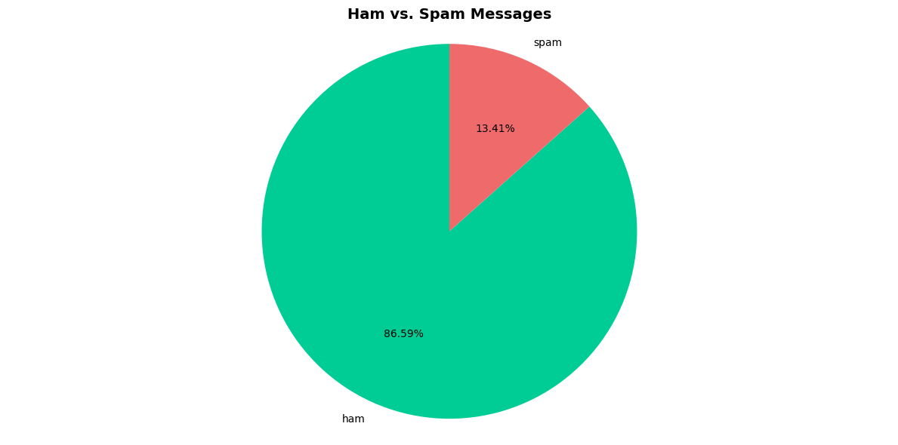
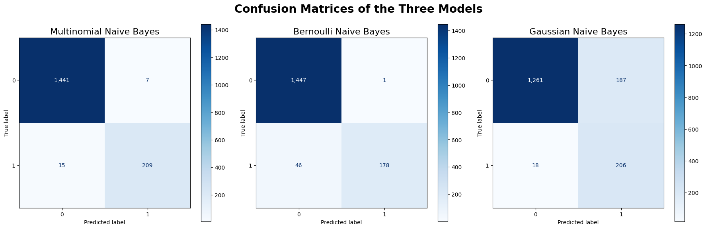
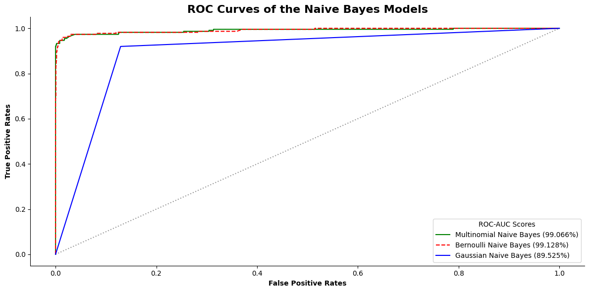
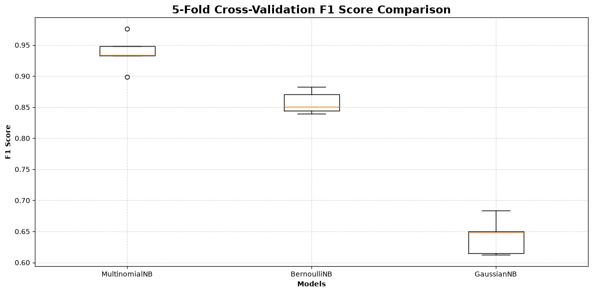
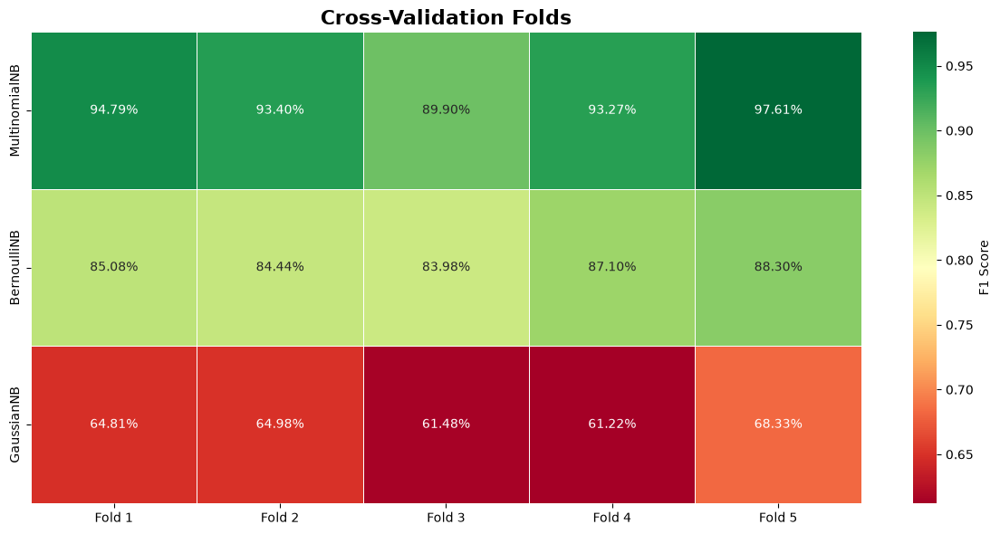
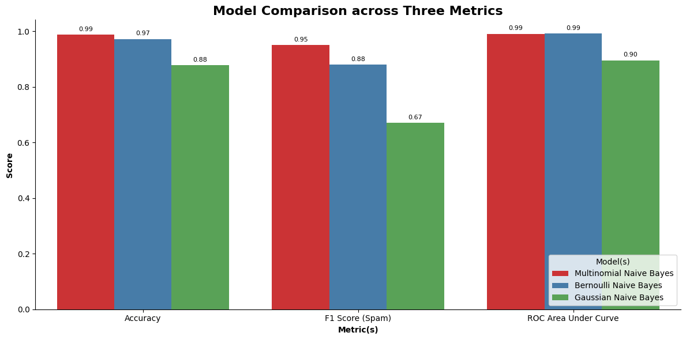

<div style="text-align: justify;">

# Introduction to Naive Bayes Classifiers

## Executive Summary

This project explores and compares three Naive Bayes classifiers—**Multinomial**, **Bernoulli**, and **Gaussian**—using the **SMS Spam Collection** Dataset from the UCI Machine Learning Repository. The goal was to classify text messages as spam or ham (non-spam) through preprocessing, encoding, and applying probabilistic machine learning models.

The dataset contained roughly **87% ham** and **13% spam**, showing a natural imbalance. The analysis focused on model performance, overfitting checks, and generalization ability through metrics like **accuracy, precision, recall, F1 score**, and **ROC-AUC**.


***Figure 01:** Ham vs. Spam Distribution.*

***A video presentation explaining the project can be found [here](https://www.linkedin.com/posts/tasnimtalha09_have-you-ever-wondered-how-your-messaging-activity-7396386394614460416-3SYG?utm_source=share&utm_medium=member_desktop&rcm=ACoAADzHX0oB0t4dpMRgmmkbZZhC5z3UQS7rZrw).***


## Business Problem
With the rising volume of spam in digital communication, automated detection is critical for both user safety and system efficiency. The business problem addressed is:  
> ***Can we accurately classify SMS messages as spam or ham using probabilistic learning methods while balancing false positives (legitimate messages flagged as spam) and false negatives (spam messages passing through)?***

This study evaluates three Naive Bayes variants to determine which provides the best trade-off between accuracy, recall, and precision for real-world spam filtering applications.

## Methodology

### Data Preparation
As can be seen from the pie chart above, the dataset is imbalanced with a higher proportion of ham messages compared to spam messages. So, we will preserve this imbalance in our training and testing datasets with the code `stratify = sms["label_encoding"]`.

The **three** naive bayes models require different types of encoders:
1. **Multinomial Naive Bayes**: `CountVectorizer()`
2. **Bernoulli Naive Bayes**: `CountVectorizer(binary = True)`
3. **Gaussian Naive Bayes**: `TfidfVectorizer()`

Each vectorizer is bundled with its classifier in a scikit-learn `Pipeline`, so the vocabulary and TF-IDF weights are learned only from training data (no preprocessing leakage), including inside each cross-validation fold.

### Model Training & Performance Evaluation
Now, We fit each pipeline on the raw training text, predict the test text, and evaluate the models using accuracy, precision, recall, F1 score, and ROC-AUC.

#### Accuracy & Classification Report
A summary of the accuracy scores along with their classification reports (precision, recall, F1 score) of the three models on the test dataset are as follows:

***Table 01:** Model Performance Comparison of Spam (Class 1).*
| *Model* | Accuracy | Precision | Recall | F1 Score |
|:------|:----------|:-----------|:--------|:----------|
| ***MultinomialNB*** | 98.68% | 0.97 | 0.93 | 0.95 |
| ***BernoulliNB*** | 97.19% | 0.99 | 0.79 | 0.88 |
| ***GaussianNB*** | 87.74% | 0.52 | 0.92 | 0.67 |

##### Key Insights
For detecting spam messages (class 1), **Multinomial Naive Bayes** achieved the best balance with precision = 0.97, recall = 0.93, and F1 = 0.95, correctly identifying most spam messages with very few false alarms. **Bernoulli Naive Bayes** was ranked second, and **Gaussian Naive Bayes** performed the worst.

#### Confusion Matrices
We generated the three confusion matrices for the models and displayed them side-by-side for an easier comparison.


***Figure 02:** Confusion Matrices.*

##### Key Insights
Our goal is to minimize either false positives or false negatives, depending on what matters more for the application.

* If we want to avoid flagging legitimate (ham) messages as spam, the best model is **Bernoulli Naive Bayes**, which produced only 1 false positive out of 1448. This is ideal when missing important emails (like business or bank messages) is unacceptable.

* If we want to avoid letting spam slip through, the best model is **Multinomial Naive Bayes**, with only 15 false negatives out of 224. This model suits scenarios where security and spam filtering are top priorities.

* For a balanced trade-off, **Multinomial Naive Bayes** again performs best, catching almost all spam messages (209 true positives) while keeping both error types low.


#### ROC Curves & ROC-AUC Scores
We also plotted the ROC curves of all three models together for a visual comparison. The ROC-AUC scores are also mentioned in the legend.


***Figure 03:** ROC Curves & ROC-AUC Scores.*

##### Key Insights
The ROC curves show that **Multinomial Naive Bayes** and **Bernoulli Naive Bayes** both achieved excellent discrimination ability between spam and ham messages, with AUC scores of 99.066% and 99.128% respectively. They can be considered almost equal if we account for the decimal places. In contrast, **Gaussian Naive Bayes** performed notably worse, with an AUC of 89.53%, showing that it is less effective at distinguishing between the two classes.

#### Overfitting Check
Before finally selecting a model, we want to check whether any of the models have any overfitting issues. Usually one of the telltale signs of overfitting is **a large difference between the training and testing f1 scores of a model**. If a model has a very high training f1 score but a significantly lower testing f1 score, it may be overfitting the training data.

```
Train & Test F1 Scores (Spam) & their Differences

For Multinomial Naive Bayes
Train F1: 97.62%
Test F1: 95.00%
Difference in F1: 2.62%

For Bernoulli Naive Bayes
Train F1: 94.16%
Test F1: 88.34%
Difference in F1: 5.83%

For Gaussian Naive Bayes
Train F1: 81.15%
Test F1: 66.77%
Difference in F1: 14.37%
```

##### Key Insights
The train–test comparison shows that **Multinomial Naive Bayes** generalizes best, with nearly identical training (99.36%) and testing (98.68%) accuracies—a minimal 0.67% gap. **Bernoulli Naive Bayes** also performs consistently, with only a slightly higher gap (1.32%). In contrast, **Gaussian Naive Bayes** shows a large 6.03% gap, indicating overfitting and poor generalization to unseen data. Overall, **MultinomialNB** is the most reliable for spam detection, while **GaussianNB** struggles due to its mismatch with text-based features.


#### Cross-Validation Check

Now, we want to have another check on how our models perform on new and unseen data. Another method of testing this is through cross-validation. For this dataset, we perform a **k-Fold Cross Validation**, For our use case, we use a `k = 5`, i.e., a 5-Fold Cross Validation.

```
Cross Validation Results of the Three Models

Multinomial Naive Bayes: 93.79% ± 2.50%
Bernoulli Naive Bayes: 85.78% ± 1.65%
Gaussian Naive Bayes: 64.16% ± 2.62%
```


***Figure 04:** Cross-Validation Results.*

##### Key Insights
Among the three, **Multinomial Naive Bayes** performed best, followed closely by **Bernoulli Naive Bayes**, while **Gaussian Naive Bayes** lagged behind. Multinomial and Bernoulli models showed strong generalization and consistency across folds, confirming no overfitting. GaussianNB underperformed because its assumption of continuous, normally distributed features doesn’t fit text-based data.

To check their performance across the folds, we can visualize the results using a heatmap.


***Figure 05:** Cross-Validation Heatmap.*

##### Key Insights
The fold-level results show whether the models' relative performance remains consistent across the five validation folds. **MultinomialNB** achieved the highest F1-score in every fold, reinforcing its position as the strongest performer in this comparison. **BernoulliNB** had a lower mean F1-score but less variation across folds, while **GaussianNB** consistently performed worst. These results support selecting MultinomialNB for further consideration, although the final assessment should also account for the held-out test results and the practical costs of false positives and false negatives.

#### Best Model Selection
Finally, we want to compare the performance of the three models across **three** specific metrics: Accuracy, F1 Score, and ROC-AUC Score. We will create a bar plot for each metric to visually compare the models.


***Figure 06:** Final Model Comparison.*

##### Key Insights
As shown in the chart, Multinomial Naive Bayes achieved the highest test accuracy and spam-class F1-score, while Bernoulli Naive Bayes achieved a marginally higher ROC-AUC. GaussianNB performed worst across all three metrics.

Given the importance of balancing precision and recall when detecting spam in this imbalanced dataset, **Multinomial Naive Bayes** is the strongest overall candidate among the three models.

## Conclusion

Based on the evaluation results, **Multinomial Naive Bayes** emerged as the strongest overall model for this SMS spam classification task. It achieved 98.68% test accuracy and a 95.00% spam-class F1-score, while also recording the highest mean cross-validation F1-score (93.79% ± 2.50%). Its strong performance with word-count features makes it a suitable candidate for this text classification problem.

It makes the perfect sense since it accounts for how many times one word appears in a text. Gaussian Naive Bayes performed poorly because this dataset was a text-based one and GNB performs the best in numeric features. Although the dataset was encoded using TF-IDF, this model was not the best one for this dataset.

**Performance of MNB**:

| Metric | Value |
|:-------|:------|
| Accuracy |  98.68%|
| Precision |  97%|
| Recall |  93%|
| F1 Score |  95%|
| False Positive Rate |  0.48%|
| False Negative Rate |  6.70%|
| ROC-AUC |  99.07%|

So, to rank the performance of the **three** models:
1. Multinomial Naive Bayes
2. Bernoulli Naive Bayes
3. Gaussian Naive Bayes

</div>